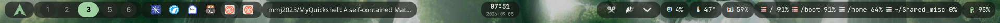

# MyQuickshell

A self-contained Quickshell desktop shell for Wayland compositors. It renders a
top bar (clock, workspaces, system tray) with a Material 3 theme, built on top
of [Quickshell](https://quickshell.outfoxxed.me) (requires >= 0.3.1, Qt 6).

This is a starting point: a single top bar, structured so that more modules
(control center, dock, notifications, lock, ...) can be added following the
same conventions. The bar includes a Notes button that opens a file-based
plain-text editor with tabs, Open/Save/New actions, optional line numbers,
configurable autosave, and a Markdown preview that renders note contents without
changing the saved Markdown source. File dialogs default to
`~/Documents/notes/`. When the optional Neovim backend is available, Neovim
owns the active buffer and editor state; QML document/session data mirrors
accepted backend snapshots for persistence, and the overlay displays that
state in the themed QML editor surface. The editable Qt Quick text editor is
used only when the optional backend is unavailable. The command-line prompt is
rendered by QML and forwards Ex commands to headless Neovim; Neovim's own
terminal UI is not embedded or rendered. Each Notes document maps to a Neovim
buffer: the QML document tabs select those buffers, and Neovim buffer navigation
(such as `:bnext` and `:bprevious`) also selects the matching Notes tab. These are
buffers rather than Neovim tabpages, which represent window layouts. Editor
keys and completed Ex commands are passed to Neovim for processing rather than
reimplementing Vim motions in QML. The QML command prompt is a visible input
surface because headless Neovim does not render its own command line. The
prompt forwards command-line keystrokes to Neovim, preserving its built-in
completion, editing keys, and command history; completion candidates appear in
a themed menu in the Notes overlay. Vim macros are handled by Neovim; while a
macro is recording, the status bar displays its register. The
Notes-specific `:w` and `:q` actions are handled through NotesService to save
or close the current note buffer; `:q` does not close the overlay. Character,
line, and block Visual selections are rendered in the QML editor, along with
Neovim 0.13+ native multicursors when available. Use Neovim's `Q` or `zq` to
add cursors and `Ctrl-L` to clear them. The editor uses Neovim's detected
filetype and syntax groups to color text with the current shell theme; unnamed
notes default to Markdown highlighting. Notes up to 2,000 lines are highlighted
as a whole; larger documents are highlighted in 200-line chunks around the
visible editor area, with a bounded cache for recently viewed chunks. Search and
substitution matches use Neovim's regex and `hlsearch`, `incsearch`, and
`inccommand` options; the editor also reflects Neovim's `number`,
`relativenumber`, `wrap`, `cursorline`, and `tabstop` settings. `:set` and Lua
option changes are reflected in the Notes view. Search highlights are transient
by default; enable persistent matches with `:set hlsearch` or
`:lua vim.opt.hlsearch = true`. Line numbers default to both absolute and
relative (`:set nu relativenumber`).

> Requires a compositor with the wlr-layer-shell protocol (Hyprland, river,
> sway, and friends all support it). Workspace state is read via `hyprctl`; the
> bar degrades gracefully on other compositors, simply hiding that widget.
> On Hyprland, right-click an inactive workspace to view live previews of its
> open windows using Quickshell's native Wayland screencopy support.
> When CPU and memory widgets are both enabled, click each metric in the
> combined pill to expand its reading; right-click either metric to open the
> corresponding live System Monitor tab. Click a GPU reading to open the GPU
> overview. GPU cards are stacked in a scrollable list and expose available
> utilization, VRAM, memory-controller, temperature, power, and device identity
> details. Processor and memory tabs also summarize GPUs with measurable
> activity. The overview also includes a searchable, sortable process list
> with user/system and per-GPU filters and per-process
> signal controls; terminating signals require confirmation and signaling is
> limited to processes owned by the current user.
> Detected DRM graphics devices are listed in the pill and GPU overview; live
> utilization and per-process attribution depend on metrics exposed by each
> device's driver.

## Runtime dependencies

- **Required:** Quickshell 0.3.1 or newer with Qt 6, and a Wayland compositor
  supporting `wlr-layer-shell`.
- **Hyprland integration:** `hyprctl` is used for workspace state and related
  compositor actions; those widgets are unavailable outside Hyprland.
- **Battery power modes (optional):** ASUS laptops use `asusctl` to select
  Quiet, Balanced, and Performance profiles. Other systems use
  `powerprofilesctl` from power-profiles-daemon for the profiles supported by
  that daemon. Battery and connected-device information remain available if
  the relevant tool is missing; the overview reports when profile control is
  unavailable.
- **Neovim Notes backend (optional dependencies):**
  - `nvim` (Neovim executable) runs as a headless embedded child process.
  - Python 3 runs the repository's `Services/NotesNvimBridge.py` adapter.
  - The Python `pynvim` package connects the adapter to Neovim's embedded RPC
    interface. It can be installed with `python -m pip install --user pynvim`
    or through the system's Python package manager.
  - Native multicursor editing and display require Neovim 0.13 or newer.
    Earlier Neovim versions retain normal Vim editing and Visual selections,
    but do not provide native multicursors.
  - The adapter exchanges JSON-line requests and buffer/cursor/mode snapshots
    with the QML `NotesService`. Each Notes document has a corresponding
    Neovim buffer. The QML editor forwards keyboard input and cursor placement
    to Neovim and displays the returned buffer and Neovim-provided syntax
    groups in the shell theme; its command prompt forwards Ex commands,
    including buffer navigation. Input and state snapshots use separate
    Neovim RPC connections so pending multi-key commands do not block later
    keystrokes. Neovim's own UI is not rendered.
  - MyQuickshell does not vendor Neovim, Python, or `pynvim`. If Neovim, Python,
    `pynvim`, or backend startup is unavailable, the Notes overlay falls back
    to the built-in Qt Quick `TextArea` editor.
- **Notes file chooser (optional):** Qt tries Zenity with
  `GTK_USE_PORTAL=1` first so GTK requests the desktop's default file chooser
  through `xdg-desktop-portal` when available. If that fails or is unavailable,
  MyQuickshell tries Zenity's GTK chooser directly, then falls back to Qt Quick's
  `FileDialog`. Install `zenity` to enable the first two chooser options; a
  portal service and a desktop-specific portal backend (such as KDE's) are
  optional and let the portal select the desktop's preferred picker.

## License

MyQuickshell is licensed under the [GNU General Public License v3.0](LICENSE) —
anyone distributing a shell derived from this code must release it under the
same license with complete source, so derivative projects stay open source.
There is no warranty, to the extent permitted by law.

Copyright (C) 2026 mmj2023

## Showcase



## Structure

- `shell.qml` - entry point
- `Common/` - app-wide singletons (`Theme`)
- `Services/` - headless singletons that talk to the system
- `Modules/Bar/` - the visible top bar
- `Modules/Bar/Widgets/` - reusable widgets (Clock, Workspaces, SystemTray)

## Running

```sh
make run        # foreground
make run-detach # background (daemonized)
```

or directly:

```sh
quickshell -p .            # foreground
quickshell -p . -d         # daemonized
```

## QML modules

| Import          | File              |
|-----------------|-------------------|
| `qs.Common`     | `Common/qmldir`   |
| `qs.Services`   | `Services/qmldir` |
| `qs.Modules.Bar`| `Modules/Bar/qmldir` |
| `qs.Modules.Bar.Widgets` | `Modules/Bar/Widgets/qmldir` |

## Theming

All colors, spacing, and typography come from `Common/Theme.qml` (Material 3
tokens: `surfaceContainer`, `onSurface`, `primary`, ...). Widgets reference
theme tokens instead of hardcoding values.

## Adding a backend (IPC seam)

`Services/DMSService.qml` is a no-op seam for a future backend (Go/Python/Rust/
C/C++). It reads a socket path from `$MYSHELL_SOCKET` and exposes
`backendAvailable`, `sendRequest()`, and `subscribe()`. Hook your backend
process here without touching the UI.

<details>
<summary>AI assistance</summary>

This project has been developed with assistance from GitHub Copilot, OpenCode,
and Antigravity. AI-generated changes are reviewed and validated by the project
maintainer.

</details>
