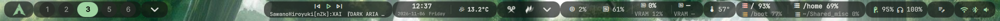

# MyQuickshell

A self-contained Quickshell desktop shell for Wayland compositors. It renders a
top bar (clock, workspaces, system tray) with a Material 3 theme, built on top
of [Quickshell](https://quickshell.outfoxxed.me) (requires >= 0.3.1, Qt 6).

This is a starting point: a single top bar, structured so that more modules
(control center, dock, notifications, lock, ...) can be added following the
same conventions. The bar includes a Notes button that opens a file-based
plain-text editor with tabs, Open/Save/New actions, optional line numbers,
configurable autosave, and a Markdown preview that renders note contents without
changing the saved Markdown source. File dialogs default to
`~/Documents/notes/`. When the optional Neovim backend is available, Neovim
owns the active buffer and editor state; QML document/session data mirrors
accepted backend snapshots for persistence, and the overlay displays that
state in the themed QML editor surface. The editable Qt Quick text editor is
used only when the optional backend is unavailable. The command-line prompt is
rendered by QML and forwards Ex commands to headless Neovim; Neovim's own
terminal UI is not embedded or rendered. Each Notes document maps to a Neovim
buffer: the QML document tabs select those buffers, and Neovim buffer navigation
(such as `:bnext` and `:bprevious`) also selects the matching Notes tab. These are
buffers rather than Neovim tabpages, which represent window layouts. Editor
keys and completed Ex commands are passed to Neovim for processing rather than
reimplementing Vim motions in QML. The QML command prompt is a visible input
surface because headless Neovim does not render its own command line. The
prompt forwards command-line keystrokes to Neovim, preserving its built-in
completion, editing keys, and command history; completion candidates appear in
a themed menu in the Notes overlay. Neovim's `showcmd` messages display pending
key sequences in the Notes status bar. Vim macros are handled by Neovim; while a
macro is recording, the status bar displays its register. The
Notes-specific `:w` and `:q` actions are handled through NotesService to save
or close the current note buffer; `:q` does not close the overlay. Character,
line, and block Visual selections are rendered in the QML editor, along with
Neovim 0.13+ native multicursors when available. Use Neovim's `Q` or `zq` to
add cursors and `Ctrl-L` to clear them. The editor uses Neovim's detected
filetype and syntax groups to color text with the current shell theme; unnamed
notes default to Markdown highlighting. Notes up to 2,000 lines are highlighted
as a whole; larger documents are highlighted in 200-line chunks around the
visible editor area, with a bounded cache for recently viewed chunks. Search and
substitution matches use Neovim's regex and `hlsearch`, `incsearch`, and
`inccommand` options; the editor also reflects Neovim's `number`,
`relativenumber`, `wrap`, `cursorline`, and `tabstop` settings. `:set` and Lua
option changes are reflected in the Notes view. Search highlights are transient
by default; enable persistent matches with `:set hlsearch` or
`:lua vim.opt.hlsearch = true`. Line numbers default to both absolute and
relative (`:set nu relativenumber`).

> Requires a compositor with the wlr-layer-shell protocol (Hyprland, river,
> sway, and friends all support it). Workspace state is read via `hyprctl`; the
> bar degrades gracefully on other compositors, simply hiding that widget.
> On Hyprland, right-click an inactive workspace to view live previews of its
> open windows using Quickshell's native Wayland screencopy support.
> Alt+Tab selects the next current-workspace window; releasing Alt commits the
> selection. If Alt is still held after 150 ms, the live-preview switcher
> appears, even if Tab has been released. Ctrl latches the overlay open; a
> release of the Alt used to open it keeps it open. Re-pressing and releasing
> Alt, Esc, or clicking commits the selected window and closes the overlay.
> While latched, Tab/Shift+Tab advances the preview selection without closing
> the overlay. The pinned switcher shows open special workspaces as group
> options; Enter opens a group's apps, Tab cycles them, and Esc returns to the
> group list. Pressing and releasing Alt again while a group option is selected
> opens that group and keeps the overlay open. A second Esc closes/cancels or
> commits an app selection. If the switcher starts on a visible special
> workspace, its apps are included; the underlying regular workspace's apps
> are listed individually when there are one or two, or as a workspace group
> when there are more.
> Use Alt+Shift+Tab or Alt+grave to cycle backward. On startup, MyQuickshell
> replaces Hyprshell's matching Alt+Tab bindings so the switchers do not compete.
> Right-clicking the workspace pill outside its numbered buttons opens the
> optional ScrollOverview live workspace overview.
> When CPU and memory widgets are both enabled, click each metric in the
> combined pill to expand its reading; right-click either metric to open the
> corresponding live System Monitor tab. Click a GPU reading to open the GPU
> overview. GPU cards are stacked in a scrollable list and expose available
> utilization, VRAM, memory-controller, temperature, power, and device identity
> details. Processor and memory tabs also summarize GPUs with measurable
> activity. The overview also includes a searchable, sortable process list
> with user/system and per-GPU filters and per-process
> signal controls; terminating signals require confirmation and signaling is
> limited to processes owned by the current user.
> Detected DRM graphics devices are listed in the pill and GPU overview; live
> utilization and per-process attribution depend on metrics exposed by each
> device's driver.

## Runtime dependencies

- **Required:** Quickshell 0.3.1 or newer with Qt 6, and a Wayland compositor
  supporting `wlr-layer-shell`.
- **Hyprland integration:** `hyprctl` is used for workspace state and related
  compositor actions; those widgets are unavailable outside Hyprland. The
  Alt+Tab switcher uses Hyprland's dynamic Lua binding API and Quickshell's
  native Wayland screencopy support. Wallpaper shortcut conflict checks also
  read Lua config files under the XDG config directory using `find`; if the
  config cannot be read or a bind expression cannot be resolved, the shortcut
  is not changed.
- **Bar backdrop blur (optional):** The bar's Blur option marks the bar surface
  as a blur region through Quickshell's Wayland background-effect support. The
  compositor must support `ext-background-effect-v1`; when supported, the
  compositor blurs only the desktop behind the bar, leaving bar content sharp.
  The option starts off and does not change the compositor's global blur
  setting. On compositors without this protocol, the option has no visual
  effect.
- **Wallpapers:** MyQuickshell renders a per-screen background layer, black by
  default. The clock calendar overlay opens the wallpaper library, where you
  can choose a local file, add multiple folders, set a solid hex color, or use
  an HTTP(S) media URL. Images and animated GIFs use Qt Quick's image provider.
  Folder scanning also finds audio and video files, QML scenes, and 3D models.
  It scans each configured folder's direct contents, including symlinks to
  files; add a nested folder separately to include it. AV1/AVIF files are
  recognized alongside common image, audio, and video formats. The library
  groups items by configured folder, with collapsible groups and per-folder
  removal.
  The wallpaper shortcut opens a separate Omarchy-style image-card switcher;
  the clock overlay retains the full library and settings. Slideshow rotation
  and cover/contain fitting are configurable and persisted in `settings.json`.
  File and folder selection uses the optional Zenity portal/GTK chooser when
  available, with Qt Quick dialogs as a fallback.
- **Wallpaper videos and streams (optional):** Requires the Qt Multimedia QML
  module and a media backend with codecs/network protocols for the selected
  source. Video playback loops when possible and supports audio; the library
  overlay exposes play/pause, seek, mute, and volume controls when the source
  has audio. Audio-only files can also be selected as wallpapers. Their
  playback-synchronized visualizer uses an amplitude envelope decoded from the
  actual audio. Optional Python 3, `ffmpeg`, and `ffprobe` generate that
  waveform; without them, audio playback continues but the waveform is
  unavailable and the library reports the analysis error. The optional
  `yt-dlp` dependency resolves YouTube page URLs to direct streams; without it,
  direct media URLs and local files continue to work, but YouTube pages cannot
  be played. YouTube quality defaults to the highest available video stream,
  with separate audio when available, and optional maximum-resolution caps;
  caps fall back to the best available lower resolution. If separate tracks
  aren't available, it uses the best combined stream. If the module, resolver,
  or source format is unavailable, the wallpaper falls back to the shell
  surface color and the library reports the error. On exposed wallpaper areas,
  two-axis trackpad scrolling pans video and pinching zooms it; a mouse's
  horizontal wheel pans and vertical wheel zooms.
- **Wallpaper 3D (optional):** GLB/GLTF assets load through Qt Quick 3D
  AssetUtils and require the system Assimp importer (`assimp` on Arch); Qt Quick
  3D `.mesh` assets use the Qt Quick 3D QML module. Custom `.qml` wallpaper
  scenes can also be chosen or found in wallpaper folders; these run as QML
  components, so only add trusted scene files. Without the required Qt Quick 3D
  modules or Assimp importer, ordinary image, video, and color wallpapers
  remain available and an error is shown for a selected 3D model. On exposed
  wallpaper areas, two-axis trackpad scrolling orbits a 3D model and pinching
  zooms it, and twisting during the gesture rolls it. A mouse's horizontal
  wheel orbits and vertical wheel zooms; hold the right button while scrolling
  to roll. Alternatively, double-click the model to toggle roll mode, where
  scrolling in either direction rolls it; double-click again to exit. Models
  without their own scene background use the current theme surface color.
- **App-window wallpaper previews (optional):** choose an open app window to
  show its live preview as the wallpaper, with Pause/Resume controls to hold a
  still frame. Capturing a window requires compositor support for
  `hyprland-toplevel-export-v1`; if the window closes or capture is unavailable,
  the wallpaper falls back to the theme surface.
- **Wallpaper keyboard shortcut:** In the wallpaper library, record a chord
  and apply it to check Hyprland's reported binds, then install it through
  Hyprland's dynamic Lua binding API. The selected chord is persisted in
  `settings.json`; the binding is unbound on orderly shell shutdown. No
  Hyprland config module or reload is required. A conflict or failed query
  leaves the current binding unchanged. The check parses literal and
  statically-resolvable `hl.bind` expressions from Lua config files as well as
  consulting the live bind list. Runtime-generated binds that are not
  represented in source and are omitted from Hyprland's list cannot be found.
- **Workspace overview (optional):** the [ScrollOverview Hyprland
  plugin](https://github.com/yayuuu/hyprland-scroll-overview) provides the live
  overview opened by right-clicking the workspace pill background. Numbered
  workspace buttons continue to provide their own previews and workspace
  switching without the plugin; the overview action reports an error if it is
  unavailable. Install with `hyprpm add
  https://github.com/yayuuu/hyprland-scroll-overview`, enable with
  `hyprpm enable scrolloverview`, and reload plugins with `hyprpm reload`.
  Hyprland plugins are ABI-sensitive; use a build compatible with the exact
  installed Hyprland version.
- **Battery power modes (optional):** ASUS laptops use `asusctl` to select
  Quiet, Balanced, and Performance profiles. Other systems use
  `powerprofilesctl` from power-profiles-daemon for the profiles supported by
  that daemon. Battery and connected-device information remain available if
  the relevant tool is missing; the overview reports when profile control is
  unavailable.
- **Brightness controls (optional):** `brightnessctl` enumerates and adjusts
  detected screen backlights and keyboard backlights in Quick Settings.
  Devices are shown as separate cards with type/current level, individual
  sliders, and a per-screen pin; the shared slider controls the pinned devices.
  Screen backlights also support an optional exponential slider curve.
  Brightness controls are omitted when the tool is unavailable or no supported
  backlight devices are detected.
- **Network interface details (optional):** `iproute2` supplies the active
  route and interface address/counters shown in Quick Settings; `iw` adds
  Wi-Fi signal, frequency, and transmit-rate details. If either tool is
  unavailable, Wi-Fi scanning and NetworkManager controls still work, while
  the affected live detail fields are omitted.
- **Neovim Notes backend (optional dependencies):**
  - `nvim` (Neovim executable) runs as a headless embedded child process.
  - Python 3 runs the repository's `Services/NotesNvimBridge.py` adapter.
  - The Python `pynvim` package connects the adapter to Neovim's embedded RPC
    interface. It can be installed with `python -m pip install --user pynvim`
    or through the system's Python package manager.
  - Native multicursor editing and display require Neovim 0.13 or newer.
    Earlier Neovim versions retain normal Vim editing and Visual selections,
    but do not provide native multicursors.
  - The adapter exchanges JSON-line requests and buffer/cursor/mode snapshots
    with the QML `NotesService`. Each Notes document has a corresponding
    Neovim buffer. The QML editor forwards keyboard input and cursor placement
    to Neovim and displays the returned buffer and Neovim-provided syntax
    groups in the shell theme; its command prompt forwards Ex commands,
    including buffer navigation. Input and state snapshots use separate
    Neovim RPC connections so pending multi-key commands do not block later
    keystrokes. Neovim's own UI is not rendered.
  - MyQuickshell does not vendor Neovim, Python, or `pynvim`. If Neovim, Python,
    `pynvim`, or backend startup is unavailable, the Notes overlay falls back
    to the built-in Qt Quick `TextArea` editor.
- **Notes file chooser (optional):** Qt tries Zenity with
  `GTK_USE_PORTAL=1` first so GTK requests the desktop's default file chooser
  through `xdg-desktop-portal` when available. If that fails or is unavailable,
  MyQuickshell tries Zenity's GTK chooser directly, then falls back to Qt Quick's
  `FileDialog`. Install `zenity` to enable the first two chooser options; a
  portal service and a desktop-specific portal backend (such as KDE's) are
  optional and let the portal select the desktop's preferred picker.

## License

MyQuickshell is licensed under the [GNU General Public License v3.0](LICENSE) —
anyone distributing a shell derived from this code must release it under the
same license with complete source, so derivative projects stay open source.
There is no warranty, to the extent permitted by law.

Copyright (C) 2026 mmj2023

## Showcase



## Structure

- `shell.qml` - entry point
- `Common/` - app-wide singletons (`Theme`)
- `Services/` - headless singletons that talk to the system
- `Modules/Bar/` - the visible top bar
- `Modules/Bar/Widgets/` - reusable widgets (Clock, Workspaces, SystemTray)

## Running

```sh
make run        # foreground
make run-detach # background (daemonized)
```

These targets register the shell's desktop entry under
`$XDG_DATA_HOME/applications` (or `~/.local/share/applications`) so desktop
portals can resolve its application ID. Run `make install-desktop` separately
if you launch the shell directly.

or directly:

```sh
quickshell -p .            # foreground
quickshell -p . -d         # daemonized
```

## QML modules

| Import          | File              |
|-----------------|-------------------|
| `qs.Common`     | `Common/qmldir`   |
| `qs.Services`   | `Services/qmldir` |
| `qs.Modules.Bar`| `Modules/Bar/qmldir` |
| `qs.Modules.Bar.Widgets` | `Modules/Bar/Widgets/qmldir` |

## Theming

All colors, spacing, and typography come from `Common/Theme.qml` (Material 3
tokens: `surfaceContainer`, `onSurface`, `primary`, ...). Widgets reference
theme tokens instead of hardcoding values.

## Adding a backend (IPC seam)

`Services/DMSService.qml` is a no-op seam for a future backend (Go/Python/Rust/
C/C++). It reads a socket path from `$MYSHELL_SOCKET` and exposes
`backendAvailable`, `sendRequest()`, and `subscribe()`. Hook your backend
process here without touching the UI.

<details>
<summary>AI assistance</summary>

This project has been developed with assistance from GitHub Copilot, OpenCode,
and Antigravity. AI-generated changes are reviewed and validated by the project
maintainer.

</details>
