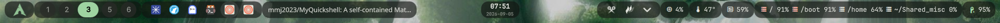

# MyQuickshell

A self-contained Quickshell desktop shell for Wayland compositors. It renders a
top bar (clock, workspaces, system tray) with a Material 3 theme, built on top
of [Quickshell](https://quickshell.outfoxxed.me) (requires >= 0.3.1, Qt 6).

This is a starting point: a single top bar, structured so that more modules
(control center, dock, notifications, lock, ...) can be added following the
same conventions. The bar includes a Notes button that opens a file-based
plain-text editor with tabs, Open/Save/New actions, optional line numbers,
configurable autosave, and a Markdown preview that renders note contents without
changing the saved Markdown source. File dialogs default to
`~/Documents/notes/`.

> Requires a compositor with the wlr-layer-shell protocol (Hyprland, river,
> sway, and friends all support it). Workspace state is read via `hyprctl`; the
> bar degrades gracefully on other compositors, simply hiding that widget.
> On Hyprland, right-click an inactive workspace to view live previews of its
> open windows using Quickshell's native Wayland screencopy support.
> When CPU and memory widgets are both enabled, click each metric in the
> combined pill to expand its reading; right-click either metric to open the
> corresponding live System Monitor tab. Click a GPU reading to open the GPU
> overview. GPU cards are stacked in a scrollable list and expose available
> utilization, VRAM, memory-controller, temperature, power, and device identity
> details. Processor and memory tabs also summarize GPUs with measurable
> activity. The overview also includes a searchable, sortable process list
> with user/system and per-GPU filters and per-process
> signal controls; terminating signals require confirmation and signaling is
> limited to processes owned by the current user.
> Detected DRM graphics devices are listed in the pill and GPU overview; live
> utilization and per-process attribution depend on metrics exposed by each
> device's driver.

## Runtime dependencies

- **Required:** Quickshell 0.3.1 or newer with Qt 6, and a Wayland compositor
  supporting `wlr-layer-shell`.
- **Hyprland integration:** `hyprctl` is used for workspace state and related
  compositor actions; those widgets are unavailable outside Hyprland.
- **Notes file chooser (optional):** Qt tries Zenity with
  `GTK_USE_PORTAL=1` first so GTK requests the desktop's default file chooser
  through `xdg-desktop-portal` when available. If that fails or is unavailable,
  MyQuickshell tries Zenity's GTK chooser directly, then falls back to Qt Quick's
  `FileDialog`. Install `zenity` to enable the first two chooser options; a
  portal service and a desktop-specific portal backend (such as KDE's) are
  optional and let the portal select the desktop's preferred picker.

## Showcase



## Structure

- `shell.qml` - entry point
- `Common/` - app-wide singletons (`Theme`)
- `Services/` - headless singletons that talk to the system
- `Modules/Bar/` - the visible top bar
- `Modules/Bar/Widgets/` - reusable widgets (Clock, Workspaces, SystemTray)

## Running

```sh
make run        # foreground
make run-detach # background (daemonized)
```

or directly:

```sh
quickshell -p .            # foreground
quickshell -p . -d         # daemonized
```

## QML modules

| Import          | File              |
|-----------------|-------------------|
| `qs.Common`     | `Common/qmldir`   |
| `qs.Services`   | `Services/qmldir` |
| `qs.Modules.Bar`| `Modules/Bar/qmldir` |
| `qs.Modules.Bar.Widgets` | `Modules/Bar/Widgets/qmldir` |

## Theming

All colors, spacing, and typography come from `Common/Theme.qml` (Material 3
tokens: `surfaceContainer`, `onSurface`, `primary`, ...). Widgets reference
theme tokens instead of hardcoding values.

## Adding a backend (IPC seam)

`Services/DMSService.qml` is a no-op seam for a future backend (Go/Python/Rust/
C/C++). It reads a socket path from `$MYSHELL_SOCKET` and exposes
`backendAvailable`, `sendRequest()`, and `subscribe()`. Hook your backend
process here without touching the UI.

<details>
<summary>AI assistance</summary>

This project has been developed with assistance from GitHub Copilot, OpenCode,
and Antigravity. AI-generated changes are reviewed and validated by the project
maintainer.

</details>
